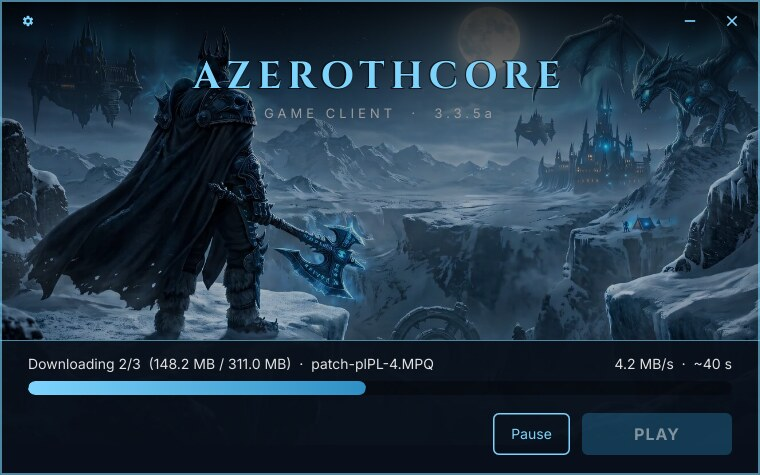

# acore-client-launcher

*[Wersja polska](README.pl.md)*

Cross-platform game client launcher and auto-updater for [AzerothCore](https://www.azerothcore.org/)
servers, for Linux and Windows. It keeps the player's WoW 3.3.5a client in sync with your file
host over HTTP(S), then starts the game. The launcher itself knows nothing about WoW: it
downloads what a manifest lists and starts one program, so a translation patch or a
`realmlist.wtf` is just another file.



*The default theme. Name, subtitle, colours, background, icon, fonts and window size are all
yours to change; see [Branding](docs/branding.md).*

One self-contained binary per platform: the UI, fonts, artwork and translations are compiled in,
nothing to install. Written in Rust with [Slint](https://slint.dev/).

## How updating works

1. **Launcher update.** If a newer launcher is published on the host, it downloads it, replaces
   itself and restarts.
2. **Game files.** It downloads the manifest (`version.json`), which lists every client file with
   its SHA-256 and size, compares it with the game folder and downloads only what is missing or
   changed, one file at a time. Every download is checked before it replaces anything.
3. **PLAY.** It starts the game — directly on Windows, through Wine on Linux — and closes once
   the game is running.

The launcher never deletes game files and ignores files the manifest does not list, so the
player's addons, screenshots and settings are safe. The only exception is **Clear cache**, and
only after the player confirms.

## Quickstart — from zero to a launcher

You only need **Docker** on the build machine.

```bash
# 1. Point the launcher at your file host (one-time edit)
#    crates/app/src/config.rs → MANIFEST_URL, GAME_PROGRAM, CACHE_DIRS

# 2. (optional) Brand it — name, colours, background, icon, fonts
#    crates/app/ui/brand.slint  +  crates/app/ui/assets/

# 3. Build the Linux and Windows binaries into out/dist/
scripts/build.sh

# 4. Generate the manifest over the client folder and upload everything to the host
out/dist/acore-launcher-cli manifest /path/to/client

# 5. Give players out/dist/acore-launcher (Linux) and out/dist/acore-launcher.exe (Windows)
```

Full walkthrough: **[Building](docs/building.md)** and **[Releasing updates](docs/releasing-updates.md)**.

## Documentation

- **[Building](docs/building.md)** — Docker setup, what `build.sh` does and where the files land,
  a local test with a throw-away web server, tests and helper scripts.
- **[Branding](docs/branding.md)** — server settings, name, colours, background, logo, icon,
  fonts, window size, and adding a language.
- **[Releasing updates](docs/releasing-updates.md)** — host layout (Apache example), publishing a
  client update, publishing a new launcher.
- **[Manifest format](docs/manifest-format.md)** — `version.json`, `launcher.json`,
  `launcher.local.json` and the files the launcher keeps in the game folder.
- **[Player guide](docs/player-guide.md)** — what players see: install, updates, tools, Wine on
  Linux.
- **[Troubleshooting](docs/troubleshooting.md)** — every error message, what causes it and how to
  fix it.

## Workspace

| Crate | Contents |
|---|---|
| `crates/core` (`launcher-core`) | Everything except the window: manifest, file check, resumable downloads, manifest generator, install, shortcuts, game start, cache, self-update. |
| `crates/cli` (`acore-launcher-cli`) | `manifest`, `launcher` and `update` (an update without the window, handy on a server and for debugging). |
| `crates/app` (`acore-launcher`) | The Slint window: `ui/*.slint`, and in `src/` the glue between the window and `core`. |

## License

- **Launcher.** MIT — see [LICENSE](LICENSE).
- **Rust dependencies.** MIT, Apache-2.0 and other permissive licenses, listed with their full
  texts in [THIRD-PARTY-LICENSES.md](THIRD-PARTY-LICENSES.md). The launcher carries that file and
  its own `LICENSE` inside the binary (About → Licenses), so nothing has to be shipped next to it.
- **Slint.** Used under its Royalty-free license, whose condition is met by the About dialog.
- **Fonts.** Cinzel and Inter, SIL Open Font License, texts in `crates/app/ui/assets/fonts/`.
- **Artwork.** The background is a placeholder. Replace it with art you have the rights to.
