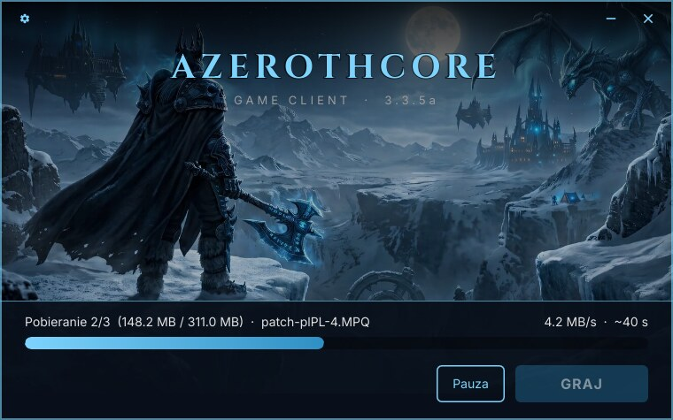

# acore-client-launcher

*[English version](README.md)*

Wieloplatformowy launcher i auto-updater klienta gry dla serwerów
[AzerothCore](https://www.azerothcore.org/), na Linuksa i Windowsa. Synchronizuje klienta gry 3.3.5a
gracza z Twoim serwerem plików przez HTTP(S), a potem uruchamia grę. Sam launcher nic nie wie
o grze: pobiera to, co wymienia manifest, i uruchamia jeden program — polska łatka czy
`realmlist.wtf` to po prostu kolejny plik.



*Domyślny motyw. Nazwę, podtytuł, kolory, tło, ikonę, fonty i rozmiar okna zmienisz sam; zobacz
[Wygląd](docs/branding.pl.md).*

Jeden samodzielny plik na system: interfejs, fonty, grafika i tłumaczenia są wkompilowane, nic
nie trzeba instalować. Napisany w Ruście z użyciem [Slint](https://slint.dev/).

## Jak działa aktualizacja

1. **Aktualizacja launchera.** Jeśli na serwerze jest nowszy launcher, pobiera go, podmienia się
   i uruchamia ponownie.
2. **Pliki gry.** Pobiera manifest (`version.json`) z listą wszystkich plików klienta, ich SHA-256
   i rozmiarem, porównuje go z folderem gry i pobiera tylko brakujące lub zmienione pliki, jeden
   po drugim. Każdy pobrany plik jest sprawdzany, zanim cokolwiek zastąpi.
3. **GRAJ.** Uruchamia grę — na Windowsie bezpośrednio, na Linuksie przez Wine — i zamyka się, gdy
   gra działa.

Launcher nigdy nie usuwa plików gry i pomija pliki, których nie ma w manifeście, więc dodatki,
zrzuty ekranu i ustawienia gracza są bezpieczne. Jedyny wyjątek to **Wyczyść cache**, i to
dopiero po potwierdzeniu.

## Szybki start — od zera do launchera

Na maszynie do budowania potrzebny jest tylko **Docker**.

```bash
# 1. Wskaż launcherowi swój serwer plików (jednorazowo)
#    crates/app/src/config.rs → MANIFEST_URL, GAME_PROGRAM, CACHE_DIRS

# 2. (opcjonalnie) Własny wygląd — nazwa, kolory, tło, ikona, fonty
#    crates/app/ui/brand.slint  +  crates/app/ui/assets/

# 3. Zbuduj pliki na Linuksa i Windowsa do out/dist/
scripts/build.sh

# 4. Wygeneruj manifest dla folderu z klientem i wgraj wszystko na serwer
out/dist/acore-launcher-cli manifest /ścieżka/do/klienta

# 5. Daj graczom out/dist/acore-launcher (Linux) i out/dist/acore-launcher.exe (Windows)
```

Pełny opis: **[Budowanie](docs/building.pl.md)** i **[Wydawanie aktualizacji](docs/releasing-updates.pl.md)**.

## Dokumentacja

- **[Budowanie](docs/building.pl.md)** — Docker, co robi `build.sh` i gdzie trafiają pliki,
  lokalny test z tymczasowym serwerem WWW, testy i skrypty pomocnicze.
- **[Wygląd](docs/branding.pl.md)** — ustawienia serwera, nazwa, kolory, tło, logo, ikona, fonty,
  rozmiar okna i dodawanie języka.
- **[Wydawanie aktualizacji](docs/releasing-updates.pl.md)** — układ plików na serwerze (przykład
  dla Apache), publikowanie aktualizacji klienta i nowego launchera.
- **[Format manifestu](docs/manifest-format.pl.md)** — `version.json`, `launcher.json`,
  `launcher.local.json` i pliki, które launcher trzyma w folderze gry.
- **[Przewodnik gracza](docs/player-guide.pl.md)** — co widzi gracz: instalacja, aktualizacje,
  narzędzia, Wine na Linuksie.
- **[Rozwiązywanie problemów](docs/troubleshooting.pl.md)** — każdy komunikat, jego przyczyna
  i sposób naprawy.

## Struktura projektu

| Crate | Zawartość |
|---|---|
| `crates/core` (`launcher-core`) | Wszystko poza oknem: manifest, sprawdzanie plików, wznawiane pobieranie, generator manifestu, instalacja, skróty, uruchamianie gry, cache, self-update. |
| `crates/cli` (`acore-launcher-cli`) | `manifest`, `launcher` i `update` (aktualizacja bez okna, przydatna na serwerze i do diagnozy). |
| `crates/app` (`acore-launcher`) | Okno Slint: `ui/*.slint`, a w `src/` połączenie okna z `core`. |

## Licencja

- **Launcher.** MIT — zobacz [LICENSE](LICENSE).
- **Zależności Rusta.** MIT, Apache-2.0 i inne licencje liberalne, z pełnymi tekstami
  w [THIRD-PARTY-LICENSES.md](THIRD-PARTY-LICENSES.md). Launcher ma ten plik i własny `LICENSE`
  wbudowane (O programie → Licencje), więc nic nie trzeba dołączać obok.
- **Slint.** Na licencji Royalty-free, której warunek spełnia okno „O programie”.
- **Fonty.** Cinzel i Inter, SIL Open Font License, teksty w `crates/app/ui/assets/fonts/`.
- **Grafika.** Tło jest tymczasowe. Zastąp je grafiką, do której masz prawa.

Autor oryginalny: [Nolt](https://github.com/nolt).

