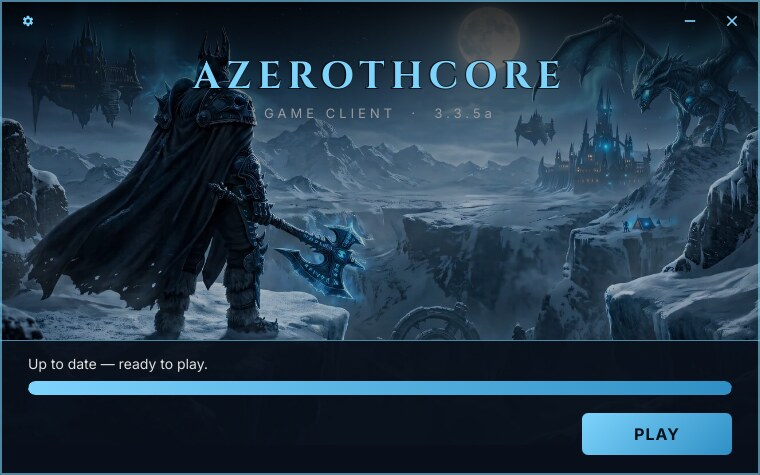

# Branding the launcher

*[Wersja polska](branding.pl.md)*



## Rebrand in 4 steps

1. **Your server** → set the manifest URL and the game program in
   [`crates/app/src/config.rs`](../crates/app/src/config.rs).
2. **Name, colours, size** → edit [`crates/app/ui/brand.slint`](../crates/app/ui/brand.slint).
3. **Background, icon, logo** → replace the files in
   [`crates/app/ui/assets/`](../crates/app/ui/assets) (keep the file names).
4. **Rebuild** → `scripts/build.sh`.

Details below. Everything here is compiled into the binary; players never see a config file.

```
crates/app/
├── src/config.rs         ← your host, what PLAY starts, what Clear cache deletes
├── build.rs              ← Windows file details (Properties → Details)
├── Cargo.toml            ← name of the binary
└── ui/
    ├── brand.slint       ← names, window size, colours, fonts (the one file for the look)
    └── assets/
        ├── background.jpg  ← background art
        ├── logo.png        ← title image, if you use one
        ├── icon.png        ← window icon and Linux menu/desktop icon (256×256)
        ├── icon.ico        ← Windows .exe icon
        └── fonts/          ← Cinzel (titles) and Inter (text) with their licences
```

## 1. Your server — `config.rs`

| Constant | Default | Meaning |
|---|---|---|
| `MANIFEST_URL` | `https://patch.example.org/version.json` | Full URL of the manifest on your host. **Set this.** |
| `LAUNCHER_INFO` | `launcher.json` | Self-update file, relative to the manifest URL. If it is missing on the host, there is simply no self-update. |
| `GAME_PROGRAM` | `Wow.exe` | What PLAY starts, relative to the game folder. On Linux a `.exe` runs through Wine. |
| `CACHE_DIRS` | `["Cache"]` | Folders **Clear cache** deletes. An empty list hides the tool. |
| `DOWNLOAD_CONCURRENCY` | `1` | Files downloaded at the same time. One by one keeps many players from saturating your upload. |

## 2. Names, size and colours — `brand.slint`

Open [`crates/app/ui/brand.slint`](../crates/app/ui/brand.slint). It is a flat list of values with
comments; nothing in it touches the launcher's logic.

### Names

| Property | Default | Where it shows |
|---|---|---|
| `server-name` | `AZEROTHCORE` | The big title, the window title (taskbar) and the About dialog. Type it **UPPERCASE** for the styled look. |
| `subtitle` | `GAME CLIENT  ·  3.3.5a` | The small line under the title. |
| `app-name` | `AzerothCore` | The name of the desktop and menu **shortcuts** and of the suggested **install folder** (`~/Games/<app-name>`, `C:\Games\<app-name>`). Use your server's name, in normal case. |

On Linux the shortcut file and its icon are named after `app-name` in lower case, e.g.
`myserver-launcher.desktop`.

### Window

| Property | Default | Meaning |
|---|---|---|
| `window-width`, `window-height` | `760px`, `475px` | Window size in logical pixels; the OS scales it for DPI. |
| `background-offset-y` | `-30px` | Moves the background art up (negative) or down, e.g. to keep a face out from under the bottom panel. |
| `frame-width` | `2px` | Width of the frame around the window; `0px` for none. |
| `title-mode` | `TitleMode.text` | What sits at the top — see below. |

### Colours

| Property | What it paints |
|---|---|
| `accent` | Title, icons, frame, progress bar, the PLAY button. |
| `accent-dark` | End of the gradient on PLAY and the progress bar. |
| `accent-highlight` | Hover colour. |
| `on-accent` | Text on the PLAY button — keep it dark for contrast. |
| `text`, `text-dim` | Status text; subtitle and descriptions. |
| `panel` | Bottom panel and dialogs. |
| `window` | Behind the background art while it loads. |
| `art-dim` | Dark layer over the whole background so it isn't too loud. `#00000000` for none. |
| `frame` | Window frame and panel edges. |
| `error` | Error text in the install dialog. |

Colours are `#RRGGBB` or `#RRGGBBAA` — the **last** two hex digits are opacity (`ff` solid, `00`
invisible). Example — a red theme:

```slint
out property <color> accent: #e74c3c;
out property <color> accent-dark: #8b0000;
out property <color> accent-highlight: #ff6b5b;
out property <color> frame: #e74c3c99;
```

### Title: text, logo or nothing

| `title-mode` | Top of the window |
|---|---|
| `TitleMode.text` (default) | `server-name` + `subtitle` |
| `TitleMode.logo` | [`assets/logo.png`](../crates/app/ui/assets) — replace it with your own (transparent PNG, shown up to 84 px high) |
| `TitleMode.none` | Nothing — for a background that already contains the title |

The window stays draggable by its top part, and the gear, minimise and close buttons stay in
every mode.

## 3. Background — `assets/background.jpg`

Replace [`assets/background.jpg`](../crates/app/ui/assets) with your own image, **keeping the
file name**.

- It covers the whole window and is cropped to fill it, so keep the important part near the
  middle. Keep it close to the window's shape (760 × 475) and about twice as large, so it stays
  sharp on high-DPI screens — the default image is 1520 × 829.
- The title sits over a dark gradient and the bottom ~130 px under the panel, so busy artwork
  there is fine.
- The default background is a placeholder. Use art you have the rights to.

## 4. Icon — `assets/icon.png` and `assets/icon.ico`

Replace **both**, keeping the file names:

- **`icon.png`** (256×256, transparent) — the window/taskbar icon on both systems, and the icon
  of the menu and desktop shortcut on Linux.
- **`icon.ico`** — the icon of the `.exe` in Windows Explorer and of the Windows shortcuts. Make it
  from the PNG with all common sizes, e.g. with ImageMagick:

  ```bash
  convert icon.png -define icon:auto-resize=256,128,64,48,32,16 icon.ico
  ```

Keep the artwork readable at 16×16 — a bold shape works better than fine text.

## 5. Fonts — `assets/fonts/`

Cinzel is used for titles and Inter for everything else; both are embedded and use the SIL Open
Font License. To use other fonts, replace the `.ttf` files and their licence texts, update the
`import` lines at the top of [`main.slint`](../crates/app/ui/main.slint) and set `title-font` /
`body-font` in `brand.slint` to the new family names.

## 6. Windows file details — `build.rs`

Properties → Details of the `.exe` shows "Game launcher". Change `FileDescription` and
`ProductName` in [`crates/app/build.rs`](../crates/app/build.rs).

## Binary name

The files are called `acore-launcher` and `acore-launcher.exe`. To rename them, change `name` in
[`crates/app/Cargo.toml`](../crates/app/Cargo.toml) and the file names in
[`scripts/build.sh`](../scripts/build.sh). Players see this name only on the downloaded file —
shortcuts use `app-name`.

## Language

The launcher is in English and Polish and picks the language from the system (`LANG` on Linux,
the display language on Windows). Any other system language gets English.

The texts live only in the `.slint` files, wrapped in `@tr(...)`. Translations are gettext `.po`
files in `crates/app/lang/<language>/LC_MESSAGES/acore-launcher.po`, compiled into the binary.

- **Change a text.** Edit the English text in the `.slint` file, refresh the template and the
  `.po` files (below), then translate the new entries.
- **Add a language.** Copy `crates/app/lang/acore-launcher.pot` to
  `crates/app/lang/<code>/LC_MESSAGES/acore-launcher.po` (`de`, `fr`, `es`, …). Fill in the
  `Language:` and `Plural-Forms:` headers, translate every `msgstr` — keep each `{}` placeholder —
  and rebuild. [`pl`](../crates/app/lang/pl/LC_MESSAGES/acore-launcher.po) is a complete example.
- **Refresh the template** after changing texts (`run` as in [Building](building.md#development)):

  ```bash
  run cargo install slint-tr-extractor
  run target/cargo-home/bin/slint-tr-extractor crates/app/ui/*.slint -o crates/app/lang/acore-launcher.pot
  run msgmerge --update --backup=none --no-wrap --no-fuzzy-matching \
      crates/app/lang/pl/LC_MESSAGES/acore-launcher.po crates/app/lang/acore-launcher.pot
  ```

  `msgmerge` adds the new texts with an empty `msgstr`; translate them.

## Previewing

You don't need a download or a server to see the result: every screen has a `MOCK` state.

```bash
MOCK=downloading out/dist/acore-launcher
LANG=pl_PL.UTF-8 MOCK=install out/dist/acore-launcher
```

`scripts/mockup-shots.sh` renders all of them to PNG in `docs/mockups/` and refreshes the images
in `docs/assets/` (see [Building](building.md#scripts)).
