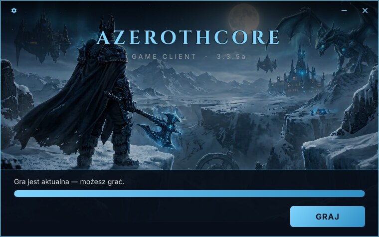

# Wygląd launchera

*[English version](branding.md)*



## Własny wygląd w 4 krokach

1. **Twój serwer** → ustaw adres manifestu i program gry w
   [`crates/app/src/config.rs`](../crates/app/src/config.rs).
2. **Nazwa, kolory, rozmiar** → edytuj [`crates/app/ui/brand.slint`](../crates/app/ui/brand.slint).
3. **Tło, ikona, logo** → podmień pliki w [`crates/app/ui/assets/`](../crates/app/ui/assets)
   (zachowaj nazwy plików).
4. **Przebuduj** → `scripts/build.sh`.

Szczegóły niżej. Wszystko to jest wkompilowane w plik wykonywalny; gracze nie widzą żadnego pliku
konfiguracyjnego.

```
crates/app/
├── src/config.rs         ← Twój serwer, co uruchamia GRAJ, co usuwa „Wyczyść cache”
├── build.rs              ← szczegóły pliku .exe (Właściwości → Szczegóły)
├── Cargo.toml            ← nazwa pliku wykonywalnego
└── ui/
    ├── brand.slint       ← nazwy, rozmiar okna, kolory, fonty (jeden plik od wyglądu)
    └── assets/
        ├── background.jpg  ← grafika tła
        ├── logo.png        ← obrazek tytułu, jeśli go używasz
        ├── icon.png        ← ikona okna oraz menu i pulpitu na Linuksie (256×256)
        ├── icon.ico        ← ikona pliku .exe na Windowsie
        └── fonts/          ← Cinzel (tytuły) i Inter (tekst) z licencjami
```

## 1. Twój serwer — `config.rs`

| Stała | Domyślnie | Znaczenie |
|---|---|---|
| `MANIFEST_URL` | `https://patch.example.org/version.json` | Pełny adres manifestu na Twoim serwerze. **Ustaw to.** |
| `LAUNCHER_INFO` | `launcher.json` | Plik self-update, względem adresu manifestu. Gdy go nie ma na serwerze, launcher po prostu się nie aktualizuje. |
| `GAME_PROGRAM` | `Wow.exe` | Co uruchamia GRAJ, względem folderu gry. Na Linuksie `.exe` idzie przez Wine. |
| `CACHE_DIRS` | `["Cache"]` | Foldery usuwane przez **Wyczyść cache**. Pusta lista ukrywa to narzędzie. |
| `DOWNLOAD_CONCURRENCY` | `1` | Ile plików pobiera się naraz. Po jednym, żeby wielu graczy nie zapchało Twojego łącza. |

## 2. Nazwy, rozmiar i kolory — `brand.slint`

Otwórz [`crates/app/ui/brand.slint`](../crates/app/ui/brand.slint). To płaska lista wartości
z komentarzami; nic w nim nie dotyka logiki launchera.

### Nazwy

| Właściwość | Domyślnie | Gdzie widać |
|---|---|---|
| `server-name` | `AZEROTHCORE` | Duży tytuł, tytuł okna (pasek zadań) i okno „O programie”. Wpisz **WIELKIMI LITERAMI** dla ozdobnego wyglądu. |
| `subtitle` | `GAME CLIENT  ·  3.3.5a` | Mała linia pod tytułem. |
| `app-name` | `AzerothCore` | Nazwa **skrótów** na pulpicie i w menu oraz proponowanego **folderu instalacji** (`~/Games/<app-name>`, `C:\Games\<app-name>`). Wpisz nazwę swojego serwera, zwykłymi literami. |

Na Linuksie plik skrótu i jego ikona biorą nazwę z `app-name` małymi literami, np.
`myserver-launcher.desktop`.

### Okno

| Właściwość | Domyślnie | Znaczenie |
|---|---|---|
| `window-width`, `window-height` | `760px`, `475px` | Rozmiar okna w pikselach logicznych; system skaluje go do DPI. |
| `background-offset-y` | `-30px` | Przesuwa tło w górę (ujemna) lub w dół, np. żeby twarz postaci nie wchodziła pod dolny panel. |
| `frame-width` | `2px` | Grubość ramki okna; `0px` bez ramki. |
| `title-mode` | `TitleMode.text` | Co jest na górze okna — zobacz niżej. |

### Kolory

| Właściwość | Co maluje |
|---|---|
| `accent` | Tytuł, ikony, ramkę, pasek postępu, przycisk GRAJ. |
| `accent-dark` | Koniec gradientu na GRAJ i pasku postępu. |
| `accent-highlight` | Kolor po najechaniu myszą. |
| `on-accent` | Tekst na przycisku GRAJ — ciemny dla kontrastu. |
| `text`, `text-dim` | Tekst statusu; podtytuł i opisy. |
| `panel` | Dolny panel i okna dialogowe. |
| `window` | Tło pod grafiką, zanim się wczyta. |
| `art-dim` | Ciemna warstwa na całej grafice, żeby nie była zbyt jaskrawa. `#00000000` — bez przyciemnienia. |
| `frame` | Ramka okna i krawędzie paneli. |
| `error` | Tekst błędu w oknie instalacji. |

Kolory zapisuje się jako `#RRGGBB` lub `#RRGGBBAA` — **ostatnie** dwie cyfry to krycie (`ff`
pełne, `00` niewidoczne). Przykład — motyw czerwony:

```slint
out property <color> accent: #e74c3c;
out property <color> accent-dark: #8b0000;
out property <color> accent-highlight: #ff6b5b;
out property <color> frame: #e74c3c99;
```

### Tytuł: tekst, logo albo nic

| `title-mode` | Góra okna |
|---|---|
| `TitleMode.text` (domyślnie) | `server-name` + `subtitle` |
| `TitleMode.logo` | [`assets/logo.png`](../crates/app/ui/assets) — podmień na własne (przezroczysty PNG, wyświetlany do 84 px wysokości) |
| `TitleMode.none` | Nic — gdy tło zawiera już tytuł |

W każdym trybie okno da się przeciągać za górną część, a przyciski zębatki, minimalizacji
i zamknięcia zostają.

## 3. Tło — `assets/background.jpg`

Podmień [`assets/background.jpg`](../crates/app/ui/assets) na własny obraz, **zachowując nazwę
pliku**.

- Obraz wypełnia całe okno i jest przycinany, więc ważne elementy trzymaj blisko środka. Trzymaj
  proporcje zbliżone do okna (760 × 475) i mniej więcej dwukrotny rozmiar, żeby był ostry na
  ekranach o wysokim DPI — domyślny obraz ma 1520 × 829.
- Tytuł leży na ciemnym gradiencie, a dolne ~130 px pod panelem, więc gęsta grafika w tych
  miejscach nie przeszkadza.
- Domyślne tło jest tymczasowe. Użyj grafiki, do której masz prawa.

## 4. Ikona — `assets/icon.png` i `assets/icon.ico`

Podmień **oba** pliki, zachowując nazwy:

- **`icon.png`** (256×256, przezroczysty) — ikona okna i paska zadań na obu systemach oraz ikona
  skrótów w menu i na pulpicie na Linuksie.
- **`icon.ico`** — ikona pliku `.exe` w Eksploratorze i skrótów na Windowsie. Zrób ją z PNG ze
  wszystkimi typowymi rozmiarami, np. ImageMagickiem:

  ```bash
  convert icon.png -define icon:auto-resize=256,128,64,48,32,16 icon.ico
  ```

Grafika musi być czytelna w 16×16 — wyraźny kształt działa lepiej niż drobny tekst.

## 5. Fonty — `assets/fonts/`

Cinzel służy do tytułów, Inter do reszty; oba są wbudowane i na licencji SIL Open Font License.
Żeby użyć innych fontów, podmień pliki `.ttf` i ich teksty licencji, popraw linie `import` na
początku [`main.slint`](../crates/app/ui/main.slint) i ustaw w `brand.slint` `title-font` /
`body-font` na nazwy nowych rodzin.

## 6. Szczegóły pliku na Windowsie — `build.rs`

Właściwości → Szczegóły pliku `.exe` pokazują „Game launcher”. Zmień `FileDescription`
i `ProductName` w [`crates/app/build.rs`](../crates/app/build.rs).

## Nazwa pliku

Pliki nazywają się `acore-launcher` i `acore-launcher.exe`. Żeby to zmienić, popraw `name`
w [`crates/app/Cargo.toml`](../crates/app/Cargo.toml) i nazwy plików w
[`scripts/build.sh`](../scripts/build.sh). Gracze widzą tę nazwę tylko na pobranym pliku — skróty
używają `app-name`.

## Język

Launcher mówi po angielsku i po polsku i wybiera język według systemu (`LANG` na Linuksie, język
wyświetlania na Windowsie). Każdy inny język systemu dostaje angielski.

Teksty są tylko w plikach `.slint`, w `@tr(...)`. Tłumaczenia to pliki gettext `.po`
w `crates/app/lang/<język>/LC_MESSAGES/acore-launcher.po`, wkompilowane w launcher.

- **Zmiana tekstu.** Popraw angielski tekst w pliku `.slint`, odśwież szablon i pliki `.po`
  (niżej) i przetłumacz nowe wpisy.
- **Nowy język.** Skopiuj `crates/app/lang/acore-launcher.pot` do
  `crates/app/lang/<kod>/LC_MESSAGES/acore-launcher.po` (`de`, `fr`, `es`, …). Uzupełnij nagłówki
  `Language:` i `Plural-Forms:`, przetłumacz każdy `msgstr` — zostaw każde `{}` — i przebuduj.
  [`pl`](../crates/app/lang/pl/LC_MESSAGES/acore-launcher.po) to pełny przykład.
- **Odświeżenie szablonu** po zmianie tekstów (`run` jak w [Budowaniu](building.pl.md#praca-nad-kodem)):

  ```bash
  run cargo install slint-tr-extractor
  run target/cargo-home/bin/slint-tr-extractor crates/app/ui/*.slint -o crates/app/lang/acore-launcher.pot
  run msgmerge --update --backup=none --no-wrap --no-fuzzy-matching \
      crates/app/lang/pl/LC_MESSAGES/acore-launcher.po crates/app/lang/acore-launcher.pot
  ```

  `msgmerge` dopisuje nowe teksty z pustym `msgstr`; przetłumacz je.

## Podgląd

Do obejrzenia efektu nie trzeba pobierania ani serwera: każdy ekran ma swój stan `MOCK`.

```bash
MOCK=downloading out/dist/acore-launcher
LANG=pl_PL.UTF-8 MOCK=install out/dist/acore-launcher
```

`scripts/mockup-shots.sh` zapisuje wszystkie jako PNG w `docs/mockups/` i odświeża obrazki
w `docs/assets/` (zobacz [Budowanie](building.pl.md#skrypty)).
