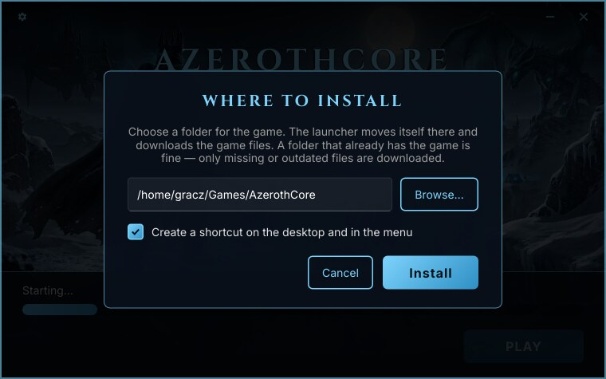
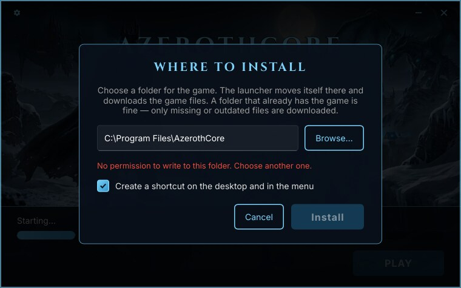
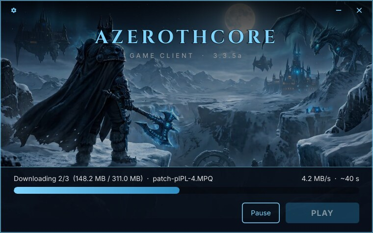
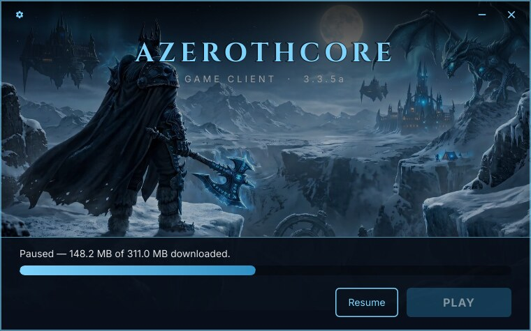
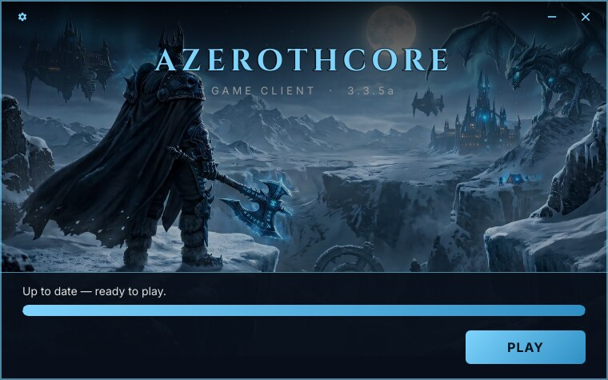
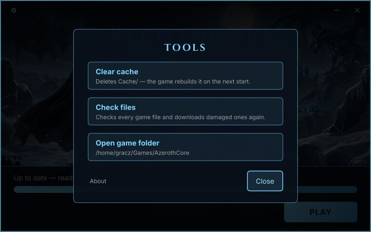
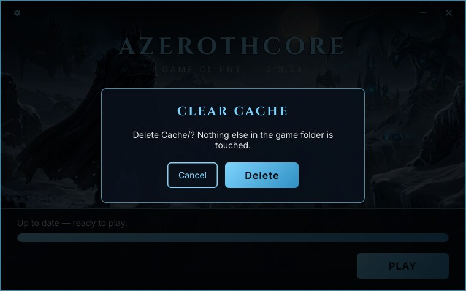
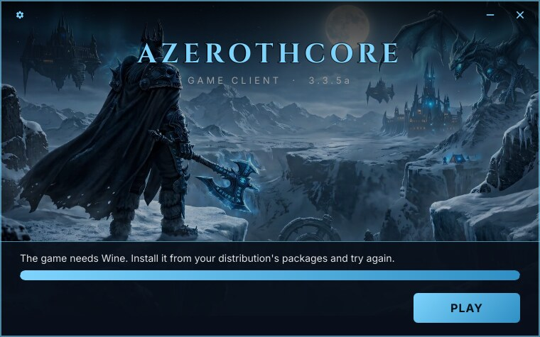

# Player guide

*[Wersja polska](player-guide.pl.md)*

How to install and use the launcher as a player. (For server admins: [Building](building.md) and
[Releasing updates](releasing-updates.md).)

## Install

Download the launcher from your server's website — `acore-launcher.exe` on Windows,
`acore-launcher` on Linux — and start it, e.g. from `Downloads`. On the first start it asks where
to install the game:



- It suggests `~/Games/<server>` on Linux and `C:\Games\<server>` on Windows. Type another path
  or pick a folder with **Browse…**.
- **A folder that already has the game is fine** — for example your existing WoW 3.3.5a folder.
  Only missing or outdated files are downloaded, your addons, screenshots and settings stay.
- Leave **Create a shortcut** ticked to get a shortcut on the desktop and in the Start Menu or
  application menu.

On **Install** the launcher moves itself into that folder, starts from there, creates the
shortcuts and deletes the copy you started from `Downloads`. From now on, start it with the
shortcut.

It never asks for administrator rights. A folder you cannot write to, such as `/opt` or
`C:\Program Files`, is refused with a message — choose another one:



## Every start

1. The launcher checks whether a newer launcher exists and, if so, updates itself and restarts.
2. It checks the game files and downloads what is missing or changed:

   

   The status line shows the file, how much is done, the speed and the time left. **Pause** stops
   the download; **Resume** continues where it stopped. You can also close the launcher — the next
   start continues the download.

   

3. When everything is up to date, press **PLAY**. The launcher starts the game and closes a few
   seconds later.

   

If the update fails — no connection, a problem on the server — the status says why and the same
button turns into **Retry**. See [Troubleshooting](troubleshooting.md).

## Tools

The gear icon (top left) opens the tools:



| Tool | What it does |
|---|---|
| **Clear cache** | Deletes the game's cache folder (`Cache/`), after asking. The game rebuilds it on the next start. Helps when item, quest or creature data looks outdated. Close the game first. |
| **Check files** | Checks every game file byte by byte (SHA-256) instead of trusting size and date, and downloads damaged ones again. Use it when the game crashes or behaves strangely. |
| **Open game folder** | Opens the game folder in your file manager. |
| **About** | Launcher version, and **Licenses** — the licenses of the launcher and every component it contains. |



## Language

The launcher speaks English and Polish and follows your system language; any other language gets
English.

## Windows

- Windows 10 or 11, 64-bit.
- The launcher is not code-signed, so on the first start Windows SmartScreen may say "Windows
  protected your PC". Click **More info** → **Run anyway**.

## Linux

- 64-bit Linux with a desktop (glibc 2.36 or newer — Debian 12, Ubuntu 22.10, Fedora 37 or later).
- After downloading, make the launcher executable: right-click → Properties → "Allow executing",
  or `chmod +x acore-launcher`.
- Start it directly — it is a native Linux program. **Don't run it through Wine.**
- The game itself is a Windows program, so it needs **Wine** (from your distribution's packages).
  Without it, PLAY says so:

  

### Choosing a Wine prefix (optional)

By default the game runs in your usual Wine prefix: `WINEPREFIX` if you set one, otherwise
`~/.wine`. For a prefix of its own, or another Wine build, create `launcher.local.json` in the
game folder:

```json
{ "winePrefix": "~/.wine-azerothcore", "wineCommand": "wine" }
```

Both fields are optional. The file also works when you start the launcher from the desktop
shortcut, where `WINEPREFIX` from a terminal is not set. The launcher never overwrites it.

### Desktop shortcut

The desktop shortcut is marked executable and, on GNOME, trusted. If your desktop still shows it
as a text file, right-click it and choose "Allow Launching".
