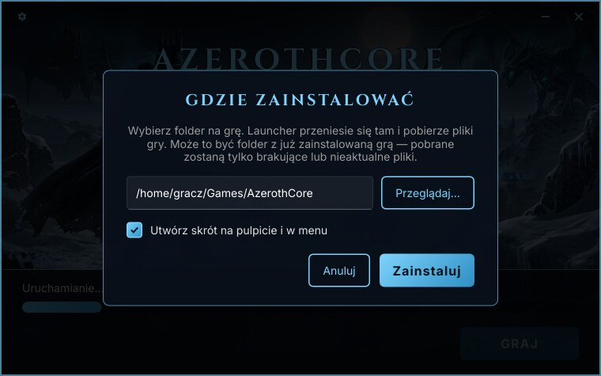
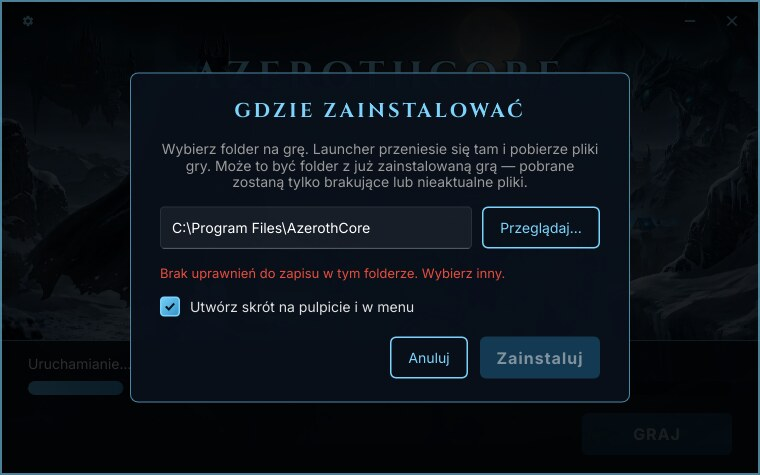
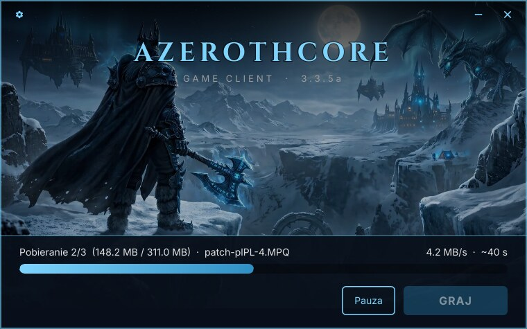
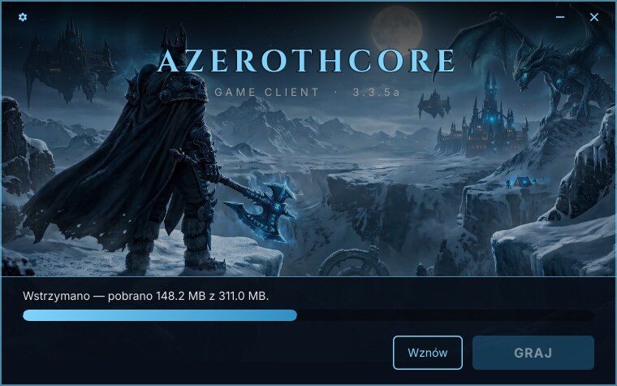
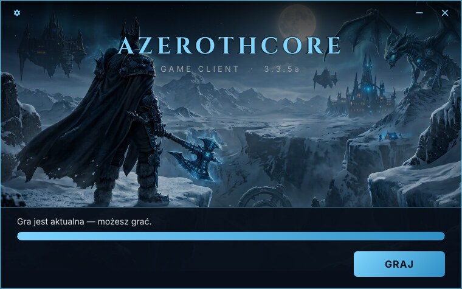
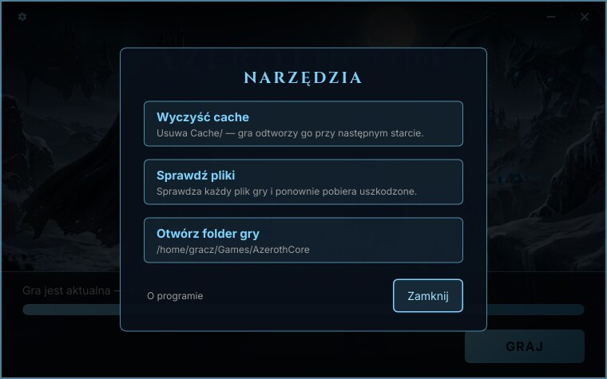
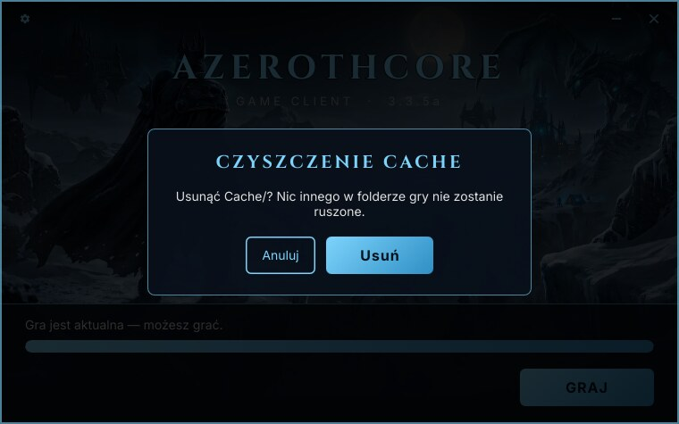
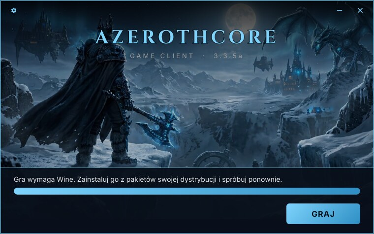

# Przewodnik gracza

*[English version](player-guide.md)*

Jak zainstalować launcher i z niego korzystać jako gracz. (Dla administratorów serwera:
[Budowanie](building.pl.md) i [Wydawanie aktualizacji](releasing-updates.pl.md).)

## Instalacja

Pobierz launcher ze strony swojego serwera — `acore-launcher.exe` na Windowsa, `acore-launcher`
na Linuksa — i uruchom go, np. z `Pobrane`. Przy pierwszym uruchomieniu zapyta, gdzie
zainstalować grę:



- Proponuje `~/Games/<serwer>` na Linuksie i `C:\Games\<serwer>` na Windowsie. Możesz wpisać inną
  ścieżkę albo wybrać folder przyciskiem **Przeglądaj…**.
- **Może to być folder z już zainstalowaną grą** — np. Twój dotychczasowy klient gry 3.3.5a. Pobrane
  zostaną tylko brakujące lub nieaktualne pliki, a dodatki, zrzuty ekranu i ustawienia zostaną.
- Zostaw zaznaczone **Utwórz skrót**, żeby dostać skrót na pulpicie i w menu Start albo menu
  aplikacji.

Po kliknięciu **Zainstaluj** launcher przenosi się do tego folderu, uruchamia się stamtąd, tworzy
skróty i usuwa kopię uruchomioną z `Pobrane`. Od teraz uruchamiaj go skrótem.

Launcher nigdy nie prosi o uprawnienia administratora. Folderu bez prawa zapisu, jak `/opt` czy
`C:\Program Files`, nie przyjmie — wybierz inny:



## Każde uruchomienie

1. Launcher sprawdza, czy jest nowsza wersja launchera, i jeśli tak, aktualizuje się
   i uruchamia ponownie.
2. Sprawdza pliki gry i pobiera brakujące lub zmienione:

   

   Status pokazuje plik, postęp, prędkość i pozostały czas. **Pauza** wstrzymuje pobieranie,
   **Wznów** kontynuuje od miejsca przerwania. Możesz też zamknąć launcher — następne
   uruchomienie dokończy pobieranie.

   

3. Gdy wszystko jest aktualne, kliknij **GRAJ**. Launcher uruchamia grę i zamyka się kilka sekund
   później.

   

Jeśli aktualizacja się nie uda — brak połączenia, problem na serwerze — status mówi dlaczego,
a ten sam przycisk zmienia się w **Ponów**. Zobacz [Rozwiązywanie problemów](troubleshooting.pl.md).

## Narzędzia

Zębatka (lewy górny róg) otwiera narzędzia:



| Narzędzie | Co robi |
|---|---|
| **Wyczyść cache** | Usuwa folder cache gry (`Cache/`), po potwierdzeniu. Gra odtworzy go przy następnym starcie. Pomaga, gdy dane przedmiotów, zadań lub stworzeń wyglądają na nieaktualne. Najpierw zamknij grę. |
| **Sprawdź pliki** | Sprawdza każdy plik gry bajt po bajcie (SHA-256) zamiast ufać rozmiarowi i dacie, i ponownie pobiera uszkodzone. Użyj, gdy gra się wysypuje albo dziwnie działa. |
| **Otwórz folder gry** | Otwiera folder gry w menedżerze plików. |
| **O programie** | Wersja launchera i **Licencje** — licencje launchera i wszystkich składników, które zawiera. |



## Język

Launcher mówi po angielsku i po polsku i wybiera język według systemu; każdy inny język systemu
dostaje angielski.

## Windows

- Windows 10 lub 11, 64-bitowy.
- Launcher nie jest podpisany cyfrowo, więc przy pierwszym uruchomieniu Windows SmartScreen może
  pokazać „System Windows ochronił ten komputer”. Kliknij **Więcej informacji** → **Uruchom mimo
  to**.

## Linux

- 64-bitowy Linux z pulpitem (glibc 2.36 lub nowsza — Debian 12, Ubuntu 22.10, Fedora 37 i nowsze).
- Po pobraniu nadaj launcherowi prawo wykonywania: prawy klik → Właściwości → „Zezwól na
  uruchamianie” albo `chmod +x acore-launcher`.
- Uruchamiaj go bezpośrednio — to natywny program na Linuksa. **Nie uruchamiaj go przez Wine.**
- Sama gra jest programem na Windowsa, więc potrzebuje **Wine** (z pakietów Twojej dystrybucji).
  Bez niego GRAJ o tym powie:

  

### Wybór prefiksu Wine (opcjonalnie)

Domyślnie gra działa w Twoim zwykłym prefiksie Wine: `WINEPREFIX`, jeśli go ustawiasz, a bez niego
`~/.wine`. Żeby gra miała osobny prefiks albo inną wersję Wine, utwórz `launcher.local.json`
w folderze gry:

```json
{ "winePrefix": "~/.wine-azerothcore", "wineCommand": "wine" }
```

Oba pola są opcjonalne. Plik działa też przy uruchamianiu launchera skrótem z pulpitu, gdzie
`WINEPREFIX` z terminala nie jest ustawiony. Launcher nigdy go nie nadpisuje.

### Skrót na pulpicie

Skrót na pulpicie jest oznaczony jako wykonywalny, a w GNOME jako zaufany. Jeśli pulpit nadal
pokazuje go jako plik tekstowy, kliknij go prawym przyciskiem i wybierz „Zezwól na uruchamianie”.
