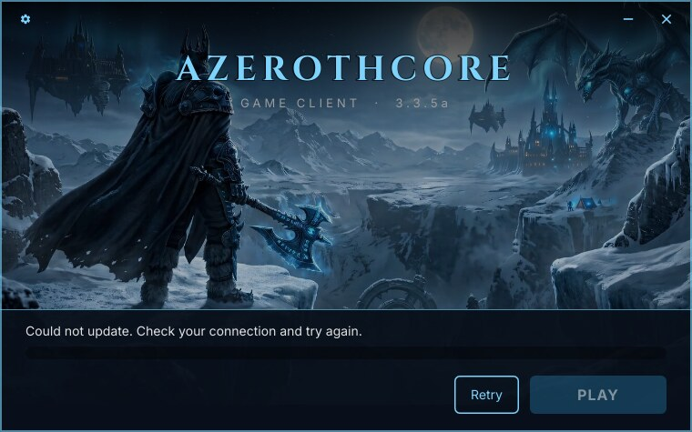

# Troubleshooting

*[Wersja polska](troubleshooting.pl.md)*

Every message the launcher shows, what causes it and how to fix it. The first section is for
players, the rest for server admins.

**Finding the exact error.** On Linux, start the launcher from a terminal — it prints the details
(URL, HTTP status, file) there. On any system,
[`acore-launcher-cli update`](building.md#updating-from-the-command-line) runs the same update
without the window and prints the error.

## Messages in the launcher

### "Could not update. Check your connection and try again."

The launcher could not reach the host at all: no internet, DNS, a firewall, TLS, or a timeout.

- Player: check the connection and press **Retry**.
- Admin: open `MANIFEST_URL` in a browser. It must be the full URL of `version.json`, e.g.
  `https://example.org/patch/version.json`, not the folder.

A dropped connection or a response cut short is retried three times before this message shows.

### "The update server is missing a file. Try again later."

The host answered, but not with the file: 404 (not found), 403 (forbidden), 5xx — or a download
did not match the manifest's size or hash three times in a row.

- 404: a file listed in `version.json` is not on the host. Upload the files first and
  `version.json` last.
- 403: the web server cannot read the files. `chmod -R a+rX /srv/patch`.
- Hash mismatch: the file on the host changed after the manifest was generated. Generate it
  again.

### "The update server sent an invalid file list. Try again later."

`version.json` is not a valid manifest: not JSON (e.g. an HTML page because `MANIFEST_URL` points
at a folder), a missing field, or a path the launcher refuses — see
[Manifest format](manifest-format.md#versionjson--game-manifest).

### "Could not write to the game folder. Close the game and try again."

A file in the game folder is locked or read-only — usually the game is still running, or the
disk is full. Close the game and press **Retry**.

### "Wow.exe is missing from the game folder. Use Check files in the tools."

The program from `GAME_PROGRAM` is not in the game folder — deleted, quarantined by an antivirus,
or the manifest does not list it. **Tools → Check files** downloads it again.

### "Wow.exe closed right after starting. Try Check files in the tools."

The game quit within 3 seconds of PLAY. Damaged files (**Check files**), or on Linux a Wine
problem — try `wine Wow.exe` in the game folder to see Wine's messages.

### "The game needs Wine. Install it from your distribution's packages and try again."

Linux only: `wine` (or the `wineCommand` from `launcher.local.json`) is not installed or not on
`PATH`.

### "Could not clear the cache. Close the game and try again."

The game keeps the cache folder open. Close it first.

### Install dialog: "No permission to write to this folder" / "Could not install to this folder"

Choose a folder in your home directory, e.g. the suggested one. The launcher never asks for
administrator rights, so `C:\Program Files` or `/opt` are refused.

## Linux

### The launcher does not start

- Make it executable: `chmod +x acore-launcher`.
- Run it directly, not through Wine.
- It needs glibc 2.36 or newer. On older systems it fails with a message about `GLIBC_2.3x`.

### Browse… does nothing

The folder dialog goes through the desktop portal (`xdg-desktop-portal`), which every common
desktop has. On a bare window manager, install `xdg-desktop-portal-gtk` — or type the path by
hand.

### The window has square corners

Without OpenGL, Slint falls back to its software renderer, which draws the gradients without
rounded corners. Everything else works the same.

### The game uses the wrong Wine prefix

See [Player guide → Choosing a Wine prefix](player-guide.md#choosing-a-wine-prefix-optional).

## Windows

### "Windows protected your PC"

SmartScreen warns about unsigned programs. **More info** → **Run anyway**.

### The exe does not start under Wine

Only relevant when testing the Windows build on Linux: Wine 8 lacks `bcryptprimitives.dll`, which
Rust programs need. Wine 9 and newer are fine; real Windows 10/11 always has it.

## Building

### `build.sh` fails

It shows the last 30 lines of `out/build.log`; the full output is in that file. A full disk is the
most common cause — the image and `target/` take about 6 GB.

### Screenshots under Xvfb crash with a divide by zero

Slint 1.18 crashes when a monitor reports a 0 Hz refresh rate, which happens under Wine on Xvfb.
`scripts/wine-test.sh` uses an Xorg dummy display at 60 Hz for this reason; the native Linux
build on Xvfb (`scripts/mockup-shots.sh`) is not affected.
