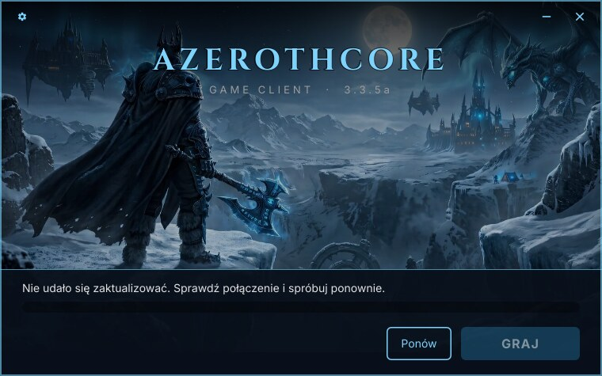

# Rozwiązywanie problemów

*[English version](troubleshooting.md)*

Każdy komunikat launchera, jego przyczyna i sposób naprawy. Pierwsza część jest dla graczy,
reszta dla administratorów serwera.

**Dokładny błąd.** Na Linuksie uruchom launcher z terminala — wypisze tam szczegóły (adres, status
HTTP, plik). Na każdym systemie
[`acore-launcher-cli update`](building.pl.md#aktualizacja-z-wiersza-poleceń) robi tę samą
aktualizację bez okna i wypisuje błąd.

## Komunikaty w launcherze

### „Nie udało się zaktualizować. Sprawdź połączenie i spróbuj ponownie.”

Launcher w ogóle nie połączył się z serwerem: brak internetu, DNS, zapora, TLS albo przekroczony
czas.

- Gracz: sprawdź połączenie i kliknij **Ponów**.
- Administrator: otwórz `MANIFEST_URL` w przeglądarce. To musi być pełny adres `version.json`,
  np. `https://example.org/patch/version.json`, a nie folder.

Zerwane połączenie albo ucięta odpowiedź są ponawiane trzy razy, zanim pojawi się ten komunikat.

### „Na serwerze aktualizacji brakuje pliku. Spróbuj później.”

Serwer odpowiedział, ale nie plikiem: 404 (nie znaleziono), 403 (brak dostępu), 5xx — albo
pobrany plik trzy razy z rzędu nie zgadzał się z rozmiarem lub hashem z manifestu.

- 404: pliku z `version.json` nie ma na serwerze. Najpierw wgrywaj pliki, a `version.json` na
  końcu.
- 403: serwer WWW nie może odczytać plików. `chmod -R a+rX /srv/patch`.
- Niezgodny hash: plik na serwerze zmienił się po wygenerowaniu manifestu. Wygeneruj go ponownie.

### „Serwer aktualizacji przysłał błędną listę plików. Spróbuj później.”

`version.json` nie jest poprawnym manifestem: to nie JSON (np. strona HTML, bo `MANIFEST_URL`
wskazuje folder), brakuje pola albo ścieżka jest odrzucana przez launcher — zobacz
[Format manifestu](manifest-format.pl.md#versionjson--manifest-gry).

### „Nie można zapisać w folderze gry. Zamknij grę i spróbuj ponownie.”

Plik w folderze gry jest zablokowany albo tylko do odczytu — zwykle gra wciąż działa albo dysk
jest pełny. Zamknij grę i kliknij **Ponów**.

### „Brak pliku Wow.exe w folderze gry. Użyj „Sprawdź pliki” w narzędziach.”

Programu z `GAME_PROGRAM` nie ma w folderze gry — usunięty, w kwarantannie antywirusa albo
manifest go nie wymienia. **Narzędzia → Sprawdź pliki** pobierze go ponownie.

### „Wow.exe zamknął się zaraz po uruchomieniu. Spróbuj „Sprawdź pliki” w narzędziach.”

Gra zamknęła się w ciągu 3 sekund od GRAJ. Uszkodzone pliki (**Sprawdź pliki**) albo na Linuksie
problem z Wine — uruchom `wine Wow.exe` w folderze gry, żeby zobaczyć komunikaty Wine.

### „Gra wymaga Wine. Zainstaluj go z pakietów swojej dystrybucji i spróbuj ponownie.”

Tylko Linux: `wine` (albo `wineCommand` z `launcher.local.json`) nie jest zainstalowany albo nie
ma go w `PATH`.

### „Nie udało się wyczyścić cache. Zamknij grę i spróbuj ponownie.”

Gra trzyma folder cache otwarty. Najpierw ją zamknij.

### Okno instalacji: „Brak uprawnień do zapisu w tym folderze” / „Nie udało się zainstalować w tym folderze”

Wybierz folder w swoim katalogu domowym, np. proponowany. Launcher nigdy nie prosi o uprawnienia
administratora, więc `C:\Program Files` czy `/opt` nie zadziałają.

## Linux

### Launcher się nie uruchamia

- Nadaj mu prawo wykonywania: `chmod +x acore-launcher`.
- Uruchamiaj go bezpośrednio, nie przez Wine.
- Wymaga glibc 2.36 lub nowszej. Na starszych systemach kończy się komunikatem o `GLIBC_2.3x`.

### Przeglądaj… nic nie robi

Okno wyboru folderu działa przez portal pulpitu (`xdg-desktop-portal`), który ma każdy popularny
pulpit. Na gołym menedżerze okien zainstaluj `xdg-desktop-portal-gtk` — albo wpisz ścieżkę ręcznie.

### Okno ma kwadratowe rogi

Bez OpenGL Slint przechodzi na renderowanie programowe, które rysuje gradienty bez zaokrąglonych
rogów. Wszystko inne działa tak samo.

### Gra używa złego prefiksu Wine

Zobacz [Przewodnik gracza → Wybór prefiksu Wine](player-guide.pl.md#wybór-prefiksu-wine-opcjonalnie).

## Windows

### „System Windows ochronił ten komputer”

SmartScreen ostrzega przed niepodpisanymi programami. **Więcej informacji** → **Uruchom mimo to**.

### `.exe` nie uruchamia się pod Wine

Dotyczy tylko testów wersji na Windowsa pod Linuksem: Wine 8 nie ma `bcryptprimitives.dll`,
którego potrzebują programy w Ruście. Wine 9 i nowsze są w porządku; prawdziwy Windows 10/11 zawsze
go ma.

## Budowanie

### `build.sh` się nie udaje

Pokazuje ostatnie 30 linii `out/build.log`; pełne wyjście jest w tym pliku. Najczęstsza przyczyna
to pełny dysk — obraz i `target/` zajmują około 6 GB.

### Zrzuty pod Xvfb kończą się dzieleniem przez zero

Slint 1.18 wysypuje się, gdy monitor zgłasza odświeżanie 0 Hz, co zdarza się pod Wine na Xvfb.
Dlatego `scripts/wine-test.sh` używa ekranu Xorg dummy z 60 Hz; natywna wersja na Linuksa pod Xvfb
(`scripts/mockup-shots.sh`) tego problemu nie ma.
